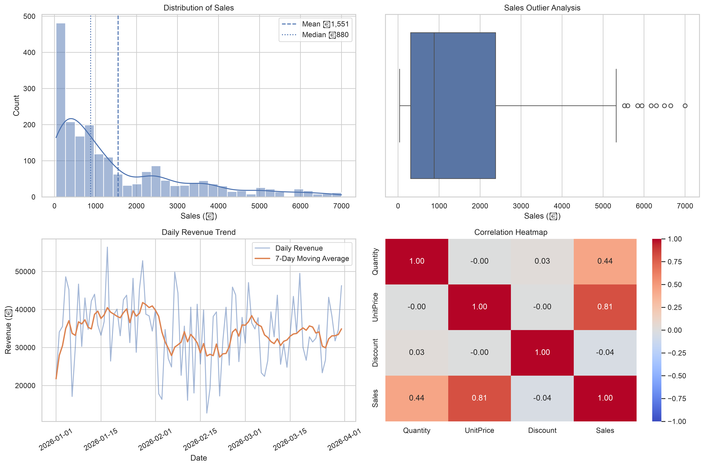
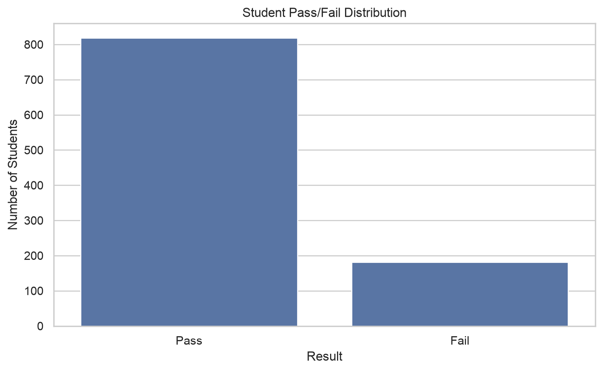
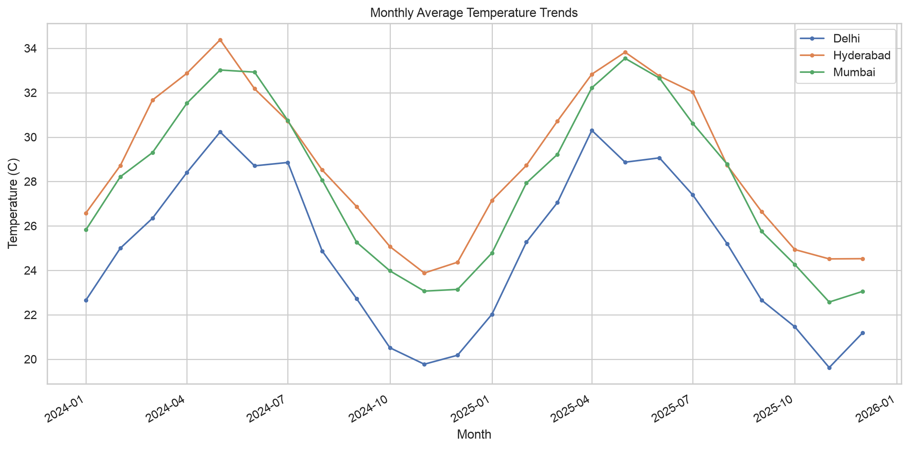
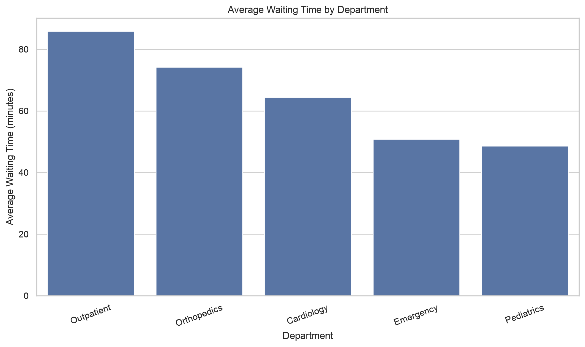
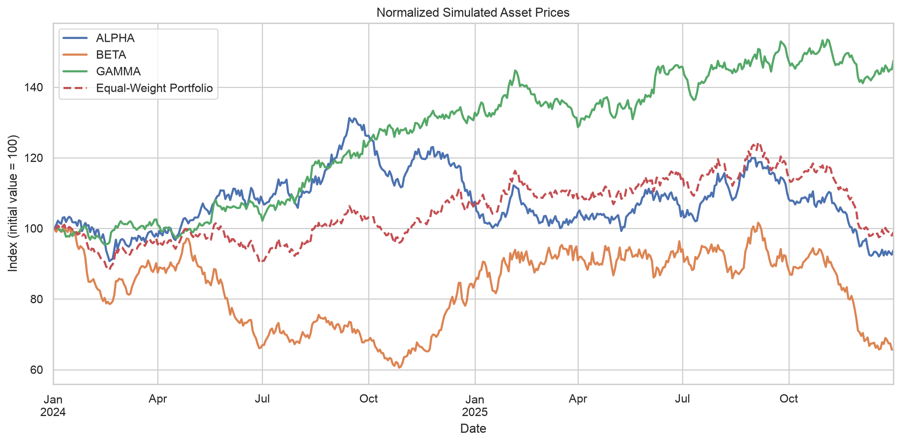

# Data Analysis and Visualization Portfolio

## The Developers Arena | Internship Task 2

A multi-domain Python Data Analysis portfolio consisting
of five independent analytical projects developed using
Pandas, NumPy, Matplotlib, Seaborn, SciPy and Jupyter.

The portfolio demonstrates the workflow from data
preparation to statistical analysis, visualization,
interpretation and professional reporting.

**Data notice:** The projects use simulated datasets
for educational and portfolio demonstration purposes.

---

## Portfolio Overview

| Metric | Files identified |
|---|---:|
| Projects | 5 |
| Jupyter Notebooks | 5 |
| PDF Reports | 5 |
| PNG Visualizations | 26 |

These counts represent existing files, not proof that
every notebook has been independently executed and tested.

## Project Navigation

| Project | Domain | Notebook | PDF Report | PNG Charts |
|---|---|---|---|---:|
| 1. Supermarket Sales Analysis | Retail | [Open file](data-analysis-portfolio/Data_Analysis_Portfolio/notebooks/01_supermarket_analysis.ipynb) | [Open file](data-analysis-portfolio/Data_Analysis_Portfolio/reports/supermarket_sales_report.pdf) | 7 |
| 2. Student Performance Analysis | Education | [Open file](student-performance-analysis/project2_student_analysis/notebooks/student_analysis.ipynb) | [Open file](student-performance-analysis/project2_student_analysis/reports/student_performance_report.pdf) | 4 |
| 3. Weather Data Analysis | Weather | [Open file](weather-data-analysis/project3_weather_analysis/notebooks/weather_analysis.ipynb) | [Open file](weather-data-analysis/project3_weather_analysis/reports/weather_analysis_report.pdf) | 5 |
| 4. Healthcare Data Analysis | Healthcare | [Open file](healthcare-data-analysis/project4_healthcare_analysis/notebooks/healthcare_analysis.ipynb) | [Open file](healthcare-data-analysis/project4_healthcare_analysis/reports/healthcare_analysis_report.pdf) | 5 |
| 5. Financial Market Analysis | Finance | [Open file](financial-market-analysis/project5_financial_analysis/notebooks/financial_analysis.ipynb) | [Open file](financial-market-analysis/project5_financial_analysis/reports/financial_market_report.pdf) | 5 |

---

## Project Descriptions


### 1. Supermarket Sales Analysis

**Domain:** Retail

**Objective:** Analyze product sales, revenue, categories, discounts and sales trends.

**Methods:** EDA, data cleaning, aggregation, descriptive statistics, correlation and revenue trends.

**Analysis:** Category revenue, product rankings, daily/monthly patterns and discount analysis.

**Limitations:** Synthetic transactions; no genuine business profitability or causal evidence.

**Notebook:** [Open file](data-analysis-portfolio/Data_Analysis_Portfolio/notebooks/01_supermarket_analysis.ipynb)

**PDF Report:** [Open file](data-analysis-portfolio/Data_Analysis_Portfolio/reports/supermarket_sales_report.pdf)





### 2. Student Performance Analysis

**Domain:** Education

**Objective:** Analyze academic performance, pass rates, subjects and attendance.

**Methods:** Data validation, median imputation, descriptive statistics, correlation and Welch t-test.

**Analysis:** Pass/fail rates, subject scores, class comparisons and attendance relationships.

**Limitations:** Synthetic student records; correlation cannot establish educational causation.

**Notebook:** [Open file](student-performance-analysis/project2_student_analysis/notebooks/student_analysis.ipynb)

**PDF Report:** [Open file](student-performance-analysis/project2_student_analysis/reports/student_performance_report.pdf)





### 3. Weather Data Analysis

**Domain:** Weather

**Objective:** Analyze temperatures, rainfall, seasonality and extreme weather indicators.

**Methods:** Datetime processing, interpolation, time-series aggregation, correlation and hypothesis testing.

**Analysis:** City comparisons, temperature trends, rainfall patterns and extreme-event frequencies.

**Limitations:** Simulated observations; not suitable for genuine climate inference or weather forecasting.

**Notebook:** [Open file](weather-data-analysis/project3_weather_analysis/notebooks/weather_analysis.ipynb)

**PDF Report:** [Open file](weather-data-analysis/project3_weather_analysis/reports/weather_analysis_report.pdf)





### 4. Healthcare Data Analysis

**Domain:** Healthcare

**Objective:** Analyze hospital visits, waiting times, stays and patient satisfaction.

**Methods:** Data cleaning, department aggregations, distributions, correlation and Welch t-test.

**Analysis:** Department waiting times, visit volumes, satisfaction and length-of-stay patterns.

**Limitations:** Synthetic hospital data; not appropriate for clinical decisions.

**Notebook:** [Open file](healthcare-data-analysis/project4_healthcare_analysis/notebooks/healthcare_analysis.ipynb)

**PDF Report:** [Open file](healthcare-data-analysis/project4_healthcare_analysis/reports/healthcare_analysis_report.pdf)





### 5. Financial Market Analysis

**Domain:** Finance

**Objective:** Analyze fictional stock prices, returns, volatility and market risk.

**Methods:** Time-series analysis, percentage returns, rolling volatility, correlation and drawdown.

**Analysis:** Risk-adjusted interpretation of returns, volatility patterns and asset relationships.

**Limitations:** Fictional financial data; not investment advice or a real-market forecast.

**Notebook:** [Open file](financial-market-analysis/project5_financial_analysis/notebooks/financial_analysis.ipynb)

**PDF Report:** [Open file](financial-market-analysis/project5_financial_analysis/reports/financial_market_report.pdf)





---

## Technical Skills Demonstrated

- Python programming
- Pandas DataFrame operations
- NumPy numerical computations
- Data cleaning and preprocessing
- Duplicate and missing-value handling
- Data validation and quality checks
- Exploratory Data Analysis
- Descriptive statistics
- Correlation analysis
- Hypothesis testing in selected projects
- Time-series and trend analysis
- Grouping, filtering and aggregation
- Matplotlib and Seaborn visualizations
- PDF reporting with ReportLab
- Reproducible analysis using Jupyter Notebooks

## Installation

```bash
python3 -m venv .venv
source .venv/bin/activate
python -m pip install -r requirements.txt
```

Open the relevant project notebook in VS Code,
select the Python virtual environment and execute
its analysis cell.

**Note:** Each original project notebook uses
its own directory conventions. Run it within the
corresponding project workspace.

## Documentation

- [Portfolio Overview](docs/portfolio_overview.md)
- [Setup Guide](docs/setup_guide.md)
- [Analysis Methodology](docs/methodology.md)
- [Technical Requirements](docs/technical_requirements.md)
- [Verification Report](docs/verification_report.md)
- [Testing Evidence](docs/testing_evidence.md)
- [Submission Checklist](docs/submission_checklist.md)
- [Presentation Outline](docs/presentation_outline.md)

## Ethical and Analytical Considerations

- Datasets are simulated.
- Statistical correlation does not prove causation.
- Hypothesis tests are educational examples.
- Business recommendations require real-world validation.
- Healthcare analysis is not clinical guidance.
- Financial analysis is not investment advice.

## Reproducibility

The source notebooks and generated outputs are
included for transparency. Rerunning notebooks may
regenerate simulated datasets, charts and reports.

## Conclusion

This portfolio demonstrates a complete learning
workflow across retail, education, weather,
healthcare and finance, combining analytical
techniques with communication and reporting.
